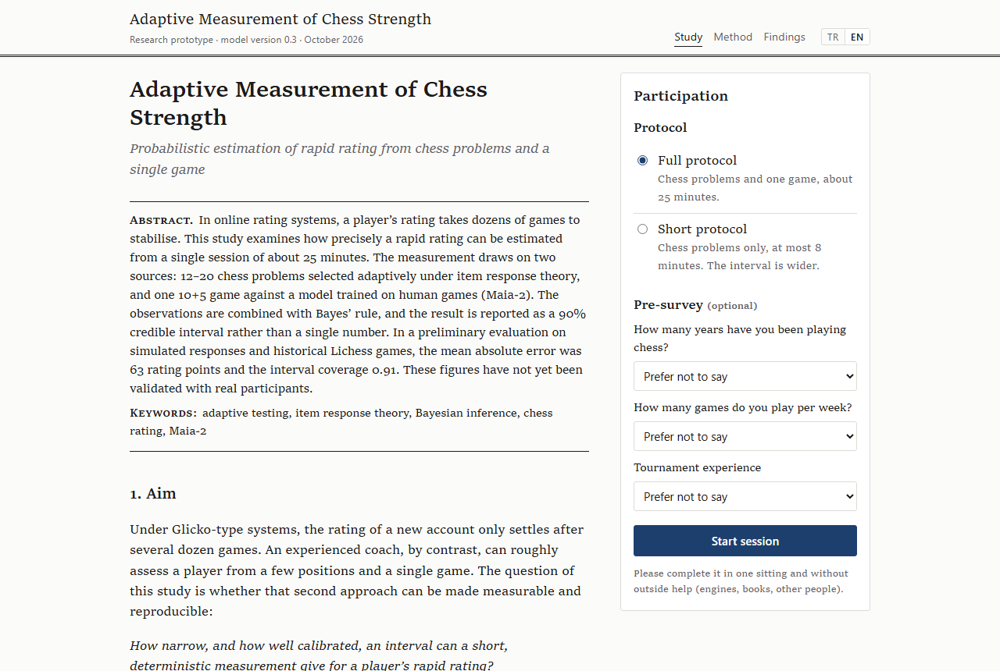
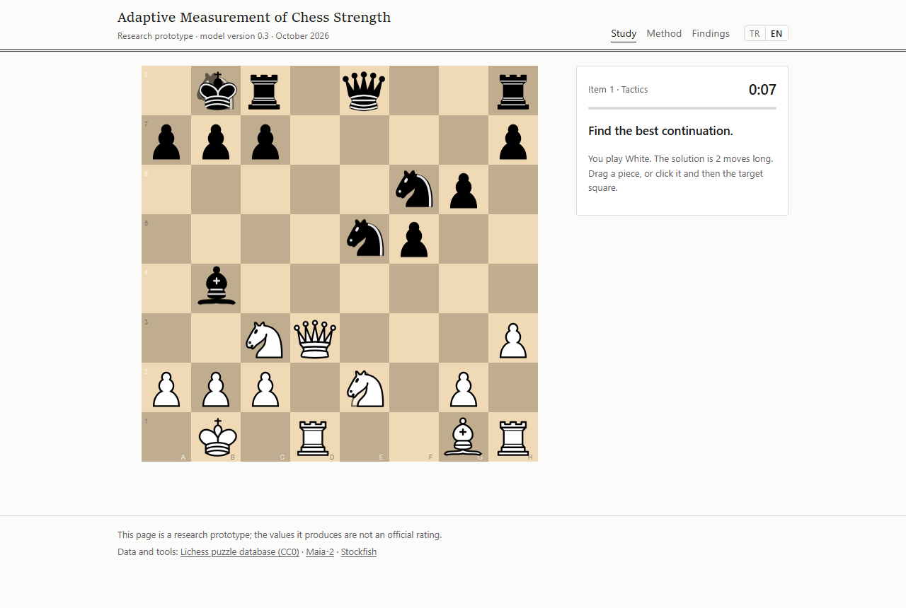

# Adaptive Measurement of Chess Strength

[Türkçe](README.tr.md)

How well can a chess player's rapid rating be estimated from one short session instead of dozens of rated games?
This repository contains a working prototype that tries to answer that question. A participant solves 12–20 chess
problems, chosen one at a time to match their level, and then plays a single 10+5 game against a model that imitates
human players. The result is a rating estimate together with a 90% interval, shown on the Lichess, Chess.com and FIDE
scales.

It is a research prototype. The numbers below come from simulations and historical Lichess games; the method has not
yet been checked against real participants.



## Try it on your computer

You need [Python](https://www.python.org/downloads/) 3.11 or newer and [Node.js](https://nodejs.org/) 20 or newer.
The first setup downloads about 700 MB (PyTorch, the Maia-2 weights, Stockfish 19 and the npm packages) and uses
about 2 GB of disk space.

```bash
git clone https://github.com/arasarkan/chess-rating-estimator.git
cd chess-rating-estimator
python scripts/setup.py
python scripts/run.py
```

`run.py` starts three local services and opens http://localhost:3000 in your browser. Press Ctrl+C to stop them.
On Windows, use `py` instead of `python` if `python` is not found.

A full session takes about 25 minutes; the short protocol (problems only) takes at most 8. Nothing leaves your
computer unless you choose to link a Lichess or Chess.com account on the report page.

If the setup is too heavy for your machine, `python scripts/setup.py --no-maia` skips PyTorch and Maia-2. Everything
still runs, but the opponent and the game analysis use a much simpler stand-in model, so the estimate is less precise.

If something does not start, the service logs are in `logs/`. Setup can be re-run at any time; finished steps are
skipped.



## How it works

The participant's strength is kept as a probability distribution over ratings from 400 to 3000, starting from a
wide prior. Each answer and each move in the game updates it with Bayes' rule.

- **Chess problems.** About 50,000 positions, mostly Lichess puzzles with stable ratings, plus positional decisions
  taken from real rapid games. The chance of solving a problem is modelled with item response theory on the Elo scale,
  and each next problem is the one expected to reduce the uncertainty most.
- **The game.** The opponent is [Maia-2](https://github.com/CSSLab/maia2), a neural network trained to predict the
  move a human of a given rating would play. For every move the participant makes, the analysis asks how likely
  players of each rating would be to choose it, and how much winning chance it gives away according to Stockfish.
- **Report.** The median of the final distribution and its 5th–95th percentile range, with sub-skills and the critical
  moments of the game.

All scoring happens on the server, Stockfish runs at a fixed node count and random choices use fixed seeds, so the
same answers always give the same result. The full description, with equations and references, is on the Method page
of the app (`/yontem`) and in [docs/CONTRACTS.md](docs/CONTRACTS.md).

## Results so far

| Condition | Mean absolute error | Share of true ratings inside the 90% interval |
| --- | --- | --- |
| Full protocol (simulated answers, real games) | 63 | 0.91 |
| Problems only (simulation) | 69 | 0.91 |
| A single real game only | 230 | 0.91 |

The game-only row uses 372 held-out Lichess rapid games from players with stable ratings. The first two rows assume
that people answer the problems the way the model expects, so they are optimistic. Details and the known weak points
are in [docs/results/](docs/results/): the problem difficulties are still derived from Lichess puzzle ratings rather
than measured on people, estimates are pulled toward the middle for very weak and very strong players, and the
Chess.com and FIDE conversions are rough.

The next step is a pilot in which participants link their online account, so that estimates can be compared with
real ratings.

## Repository layout

| Path | Contents |
| --- | --- |
| `py/chessdex/measure` | Rating grid, prior, item response model, posterior, item selection, stopping, game likelihood |
| `py/chessdex/engines` | Maia-2 wrapper, Stockfish analysis, move exclusions, integrity signals |
| `py/chessdex/bank` | Building and checking the problem bank from Lichess data |
| `py/chessdex/api` | Measurement service (FastAPI, port 8000) |
| `py/chessdex/sim` | Simulations and back-tests behind the numbers above |
| `services/game` | Game server with server-side clock (WebSocket, port 8080) |
| `apps/web` | Web interface in Turkish and English (Next.js, port 3000) |
| `docs/results` | Evaluation write-ups |

## Reproducing the research

```bash
cd py
../.venv/bin/python -m pip install -r requirements-dev.txt   # Windows: ..\.venv\Scripts\python
../.venv/bin/python -m pytest tests -q
../.venv/bin/python -m chessdex.sim.synthetic --n 1000 --bank data/bank.jsonl
```

`bash scripts/build_bank.sh` rebuilds the problem bank from the Lichess puzzle database (a 300 MB download and about an hour
of computation); the ready-made bank is included as `py/data/bank.jsonl.gz`. Settings for running the services
separately are listed in [docs/CONFIG.md](docs/CONFIG.md).

## Data and licences

- Code: GPL-3.0 (see [LICENSE](LICENSE)).
- Problems: [Lichess puzzle and game databases](https://database.lichess.org/), CC0.
- Maia-2: MIT, weights downloaded from the authors during setup.
- Stockfish 19: GPL-3.0, downloaded from the official release during setup.

Feedback and questions are welcome in the issues.
