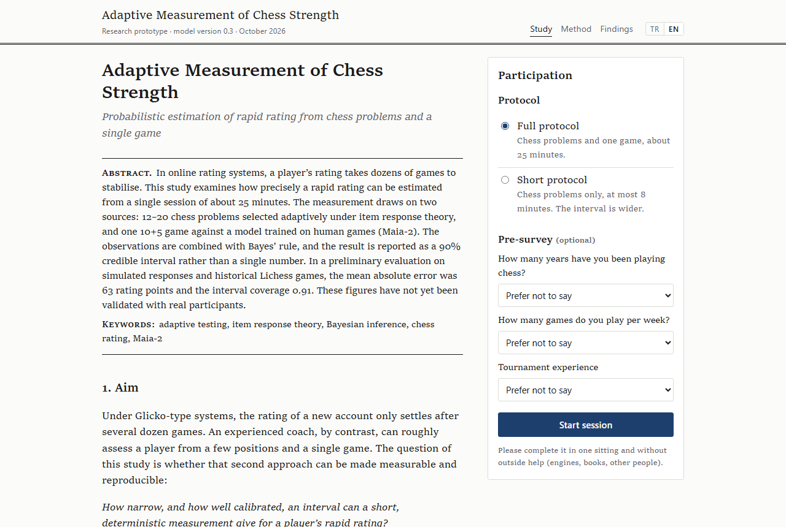
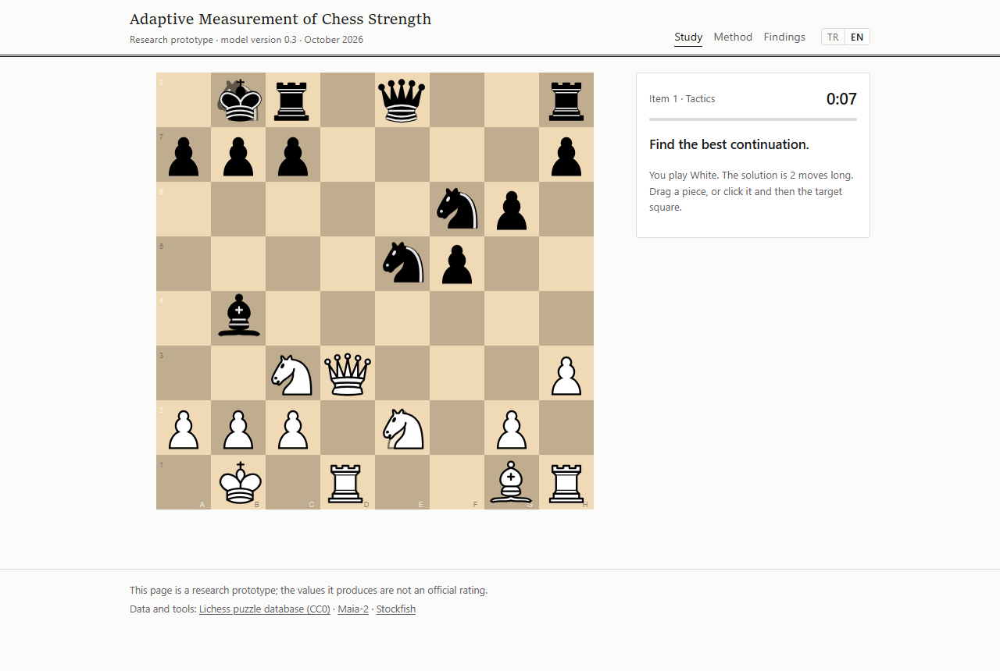

# Satranç Gücünün Uyarlamalı Ölçümü

[English](README.md)

Bir satranç oyuncusunun rapid derecelendirmesi, onlarca puanlı oyun yerine tek bir kısa oturumdan ne kadar iyi tahmin
edilebilir? Bu depo, bu soruyu yanıtlamaya çalışan çalışır bir prototip içerir. Katılımcı, seviyesine göre tek tek
seçilen 12–20 satranç sorusunu çözer, ardından insan oyuncuları taklit eden bir modele karşı tek bir 10+5 oyun oynar.
Sonuç, %90 aralığıyla birlikte bir derecelendirme tahminidir ve Lichess, Chess.com ve FIDE ölçeklerinde gösterilir.

Bu bir araştırma prototipidir. Aşağıdaki sayılar benzetimlerden ve geçmiş Lichess oyunlarından gelir; yöntem henüz
gerçek katılımcılarla sınanmamıştır.



## Kendi bilgisayarınızda deneyin

[Python](https://www.python.org/downloads/) 3.11 ya da üstü ve [Node.js](https://nodejs.org/) 20 ya da üstü
gerekir. İlk kurulum yaklaşık 700 MB indirir (PyTorch, Maia-2 ağırlıkları, Stockfish 19 ve npm paketleri) ve diskte
yaklaşık 2 GB yer kaplar.

```bash
git clone https://github.com/arasarkan/chess-rating-estimator.git
cd chess-rating-estimator
python scripts/setup.py
python scripts/run.py
```

`run.py` üç yerel servisi başlatır ve tarayıcıda http://localhost:3000 adresini açar. Durdurmak için Ctrl+C.
Windows'ta `python` bulunamazsa yerine `py` yazın.

Tam oturum yaklaşık 25 dakika, kısa protokol (yalnızca sorular) en fazla 8 dakika sürer. Rapor sayfasında bir
Lichess ya da Chess.com hesabı bağlamayı seçmedikçe hiçbir veri bilgisayarınızdan çıkmaz.

Kurulum bilgisayarınız için ağır gelirse `python scripts/setup.py --no-maia` PyTorch ve Maia-2'yi atlar. Her şey yine
çalışır, ancak rakip ve oyun analizi çok daha basit bir yedek modelle yapıldığından tahmin daha az kesin olur.

Bir servis başlamazsa günlükler `logs/` altındadır. Kurulum istendiği kadar yeniden çalıştırılabilir; tamamlanmış
adımlar atlanır.



## Nasıl çalışır

Katılımcının gücü, 400 ile 3000 arasındaki derecelendirmeler üzerinde bir olasılık dağılımı olarak tutulur ve geniş
bir önselle başlar. Her cevap ve oyundaki her hamle bu dağılımı Bayes kuralıyla günceller.

- **Satranç soruları.** Yaklaşık 50.000 pozisyon: çoğu derecelendirmesi oturmuş Lichess bulmacaları, bir kısmı gerçek
  rapid oyunlarından alınmış pozisyonel kararlar. Bir sorunun çözülme olasılığı Elo ölçeğinde madde tepki kuramıyla
  modellenir; her seferinde belirsizliği en çok azaltması beklenen soru seçilir.
- **Oyun.** Rakip [Maia-2](https://github.com/CSSLab/maia2): belirli bir derecelendirmedeki insanın hangi hamleyi
  oynayacağını tahmin etmek üzere eğitilmiş bir sinir ağı. Katılımcının her hamlesi için, her derecelendirmedeki
  oyuncuların bu hamleyi seçme olasılığına ve Stockfish'e göre hamlenin kazanma şansından ne kadar götürdüğüne bakılır.
- **Rapor.** Son dağılımın ortancası ve 5.–95. yüzdelik aralığı, alt beceriler ve oyunun kritik anları.

Tüm puanlama sunucuda yapılır; Stockfish sabit düğüm sayısıyla, rastgele seçimler sabit tohumla çalışır. Bu yüzden
aynı cevaplar her zaman aynı sonucu verir. Denklemler ve kaynaklarla birlikte ayrıntılı açıklama uygulamadaki Yöntem
sayfasında (`/yontem`) ve [docs/CONTRACTS.md](docs/CONTRACTS.md) belgesindedir.

## Şimdiye kadarki sonuçlar

| Koşul | Ortalama mutlak hata | Gerçek değerin %90 aralığa düşme oranı |
| --- | --- | --- |
| Tam protokol (benzetim cevapları, gerçek oyunlar) | 63 | 0,91 |
| Yalnızca sorular (benzetim) | 69 | 0,91 |
| Yalnızca tek bir gerçek oyun | 230 | 0,91 |

Yalnızca oyun satırı, derecelendirmesi kararlı oyunculara ait ve ayarlamada kullanılmamış 372 Lichess rapid oyununa
dayanır. İlk iki satır, insanların soruları modelin beklediği gibi cevapladığını varsaydığı için iyimserdir. Ayrıntılar
ve bilinen zayıf noktalar [docs/results/](docs/results/) altındadır. Soru zorlukları henüz insanlar üzerinde
ölçülmemiş, Lichess bulmaca derecelendirmelerinden türetilmiştir. Çok zayıf ve çok güçlü oyuncuların tahmini ortaya
doğru çekilir. Chess.com ve FIDE dönüşümleri de kabadır.

Sıradaki adım, katılımcıların çevrim içi hesaplarını bağladığı bir pilot çalışma. Böylece tahminler gerçek
derecelendirmelerle karşılaştırılabilecek.

## Depo yapısı

| Yol | İçerik |
| --- | --- |
| `py/chessdex/measure` | Derecelendirme ızgarası, önsel, madde tepki modeli, sonsal, soru seçimi, durdurma, oyun olabilirliği |
| `py/chessdex/engines` | Maia-2 sarmalayıcısı, Stockfish analizi, hamle dışlamaları, bütünlük sinyalleri |
| `py/chessdex/bank` | Lichess verisinden soru bankasının üretilmesi ve denetimi |
| `py/chessdex/api` | Ölçüm servisi (FastAPI, port 8000) |
| `py/chessdex/sim` | Yukarıdaki sayıların arkasındaki benzetimler ve geriye dönük testler |
| `services/game` | Sunucu saatli oyun sunucusu (WebSocket, port 8080) |
| `apps/web` | Türkçe ve İngilizce web arayüzü (Next.js, port 3000) |
| `docs/results` | Değerlendirme notları |

## Araştırmayı yeniden üretmek

```bash
cd py
../.venv/bin/python -m pip install -r requirements-dev.txt   # Windows: ..\.venv\Scripts\python
../.venv/bin/python -m pytest tests -q
../.venv/bin/python -m chessdex.sim.synthetic --n 1000 --bank data/bank.jsonl
```

`bash scripts/build_bank.sh` soru bankasını Lichess bulmaca veritabanından yeniden üretir (300 MB indirme ve yaklaşık bir
saatlik hesap). Hazır banka `py/data/bank.jsonl.gz` olarak depodadır. Servisleri ayrı ayrı çalıştırmak için ayarlar
[docs/CONFIG.md](docs/CONFIG.md) belgesindedir.

## Veri ve lisanslar

- Kod: GPL-3.0 ([LICENSE](LICENSE)).
- Sorular: [Lichess bulmaca ve oyun veritabanları](https://database.lichess.org/), CC0.
- Maia-2: MIT; ağırlıklar kurulum sırasında yazarların yayımladığı yerden indirilir.
- Stockfish 19: GPL-3.0; kurulum sırasında resmî sürümden indirilir.

Geri bildirim ve sorular için issue açabilirsiniz.
